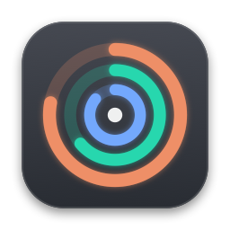
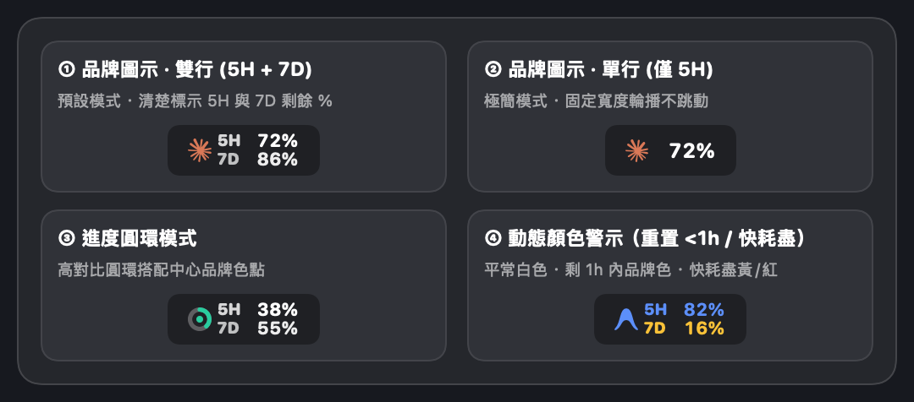
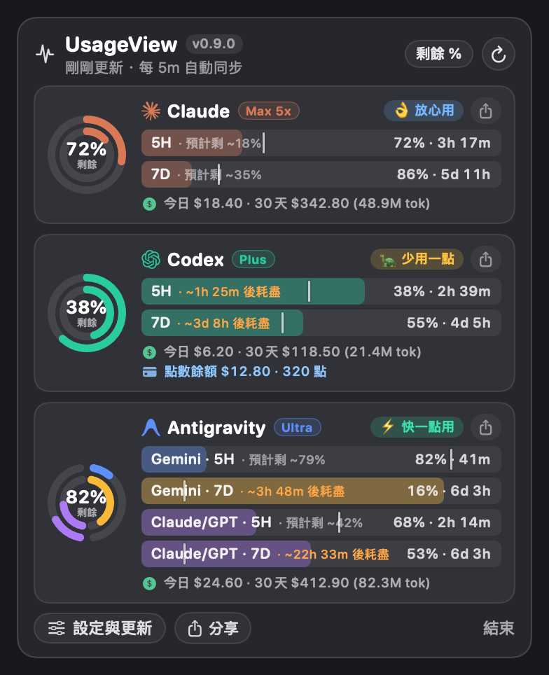
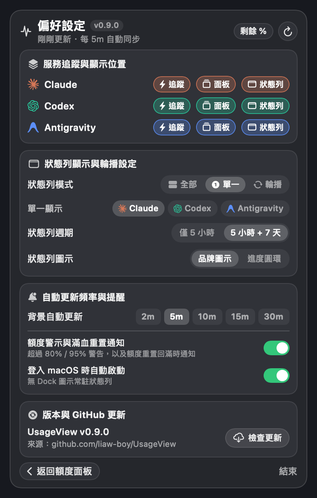

<div align="center">
  
  <h1>UsageView</h1>
  <p><b>macOS 原生狀態列 AI 額度監控工具（Claude · Codex · Antigravity）</b></p>
  <p>
    <a href="https://github.com/liaw-boy/UsageView/releases/latest/download/UsageView.dmg"></a>
    
    
    
    
  </p>
</div>

---

## 📥 快速下載安裝（`.dmg` 映像檔）

1. 點擊下載最新映像檔 👉 **[下載 `UsageView.dmg` (Latest Release)](https://github.com/liaw-boy/UsageView/releases/latest/download/UsageView.dmg)**
2. 雙擊打開 `UsageView.dmg`，將 **`UsageView.app`** 拖曳至 **`Applications`（應用程式）** 資料夾。
3. 若首次開啟時 macOS 提示未簽署開發者，可於終端機執行以下指令解除隔離屬性後直接開啟：
   ```bash
   xattr -cr /Applications/UsageView.app && open /Applications/UsageView.app
   ```

---

## 📸 畫面預覽与介面導覽

### 1. 狀態列（Menu Bar）顯示模式與動態顏色警示
支援全透明原生背景、固定等寬不跳動排版，並提供「**品牌圖示 / 進度圓環**」與「**5 小時 + 7 天雙行 / 僅 5 小時單行**」自由切換：

<p align="center">
  
</p>

- **平常狀態**：以乾淨的**白色**顯示 `5H` 與 `7D` 百分比。
- **重置倒數 `< 1 小時`**：當 `5H` 或 `7D` 額度距離重置只剩 1 小時以內時，該列自動轉為**該 AI 的專屬品牌色**（Claude 橘 / Codex 綠 / Antigravity 藍），提醒你趁重置前多加利用。
- **額度即將耗盡**：當已使用達 `80%`（剩餘 `≤ 20%`）時轉為**琥珀黃**，達 `95%`（剩餘 `≤ 5%`）時轉為**警戒紅**。

---

### 2. 主面板（展開儀表板）与偏好設定面板

<table>
  <tr>
    <td align="center" width="50%">
      <b>📊 展開主面板（雙環同心儀表 + 5 段創意配速）</b><br><br>
      
    </td>
    <td align="center" width="50%">
      <b>⚙️ 偏好設定與 GitHub 一鍵自動更新</b><br><br>
      
    </td>
  </tr>
</table>

---

## ✨ 核心特色

### 1. 狀態列（Menu Bar）全組合自訂與零跳動保證
| 設定項目 | 可選模式 | 說明 |
| :--- | :--- | :--- |
| **狀態列模式** | `全部` / `單一` / `輪播` | 可同時並排顯示多家 AI、固定單一家 AI（自動過濾未追蹤服務），或每 4 秒自動輪播切換 |
| **狀態列週期** | `僅 5 小時` / `5 小時 + 7 天` | 支援單行百分比，或雙行上下堆疊（上排 `5H`、下排 `7D`） |
| **狀態列圖示** | `品牌圖示` / `進度圓環` | 預設顯示各家官方向量圖示（Claude / Codex / Antigravity），亦可切換為高對比進度圓環 |
| **百分比模式** | `剩餘 %` / `已用 %` | 一鍵切換顯示「剩餘可用額度」或「目前已消耗額度」 |

- **固定等寬不跳動**：透過隱藏的 `"100%"` 等寬數字模板鎖定排版寬度，無論數值為 `0%`、`6%`、`72%` 或 `100%`，在輪播切換時狀態列寬度**絕不左右縮放跳動、也絕不會被截斷為 `...`**。
- **嚴格固定更新間隔**：依據磁碟快取中每家 AI 的 `fetchedAt` 時間戳與設定的更新間隔（`2m / 5m / 10m / 15m / 30m`）排程，**重啟 App 或點開面板絕不會額外重打 API**。

---

### 2. 原生深色儀表板、時間刻度預估與本機等效花費
點擊狀態列圖示後展開 **macOS 原生中性深灰（`#25272C` / `#303238`）** 面板，完整列出所有已啟用追蹤的 AI 服務：
- **訂閱方案等級標籤（Plan Badge）與額外點數**：自動解析並顯示各家訂閱方案（如 Claude `Max 5x` / `Max 20x` / `Pro`、Codex `Plus` / `Pro 200` / `Pro 500`、Antigravity `Ultra` / `Pro`），以及 Claude 額外付費額度（`Extra Usage`）或 Codex 點數餘額（`Credits`）。
- **進度條「時間基準刻度線」與耗盡/剩餘預估**：
  - 每條 5 小時與 7 天進度條上皆繪製一條**白色垂直刻度線**，標示目前時間已走過週期的比例。
  - 自動依消耗速率顯示 **`重置前預計剩 ~XX%`** 或 **`⚠️ 約 Xh Ym 後耗盡`**。
- **💰 本機 Token 與 API 等效美金統計**：100% 離線掃描本機 `~/.claude/projects`、`~/.codex/sessions` 與 `~/.gemini/antigravity*/conversations`，於卡片底部顯示**今日與近 30 天累計 Token 數及官方 API 等效美金價值**（例如 `今日 $18.40 · 30天 $342.80 (48.9M tok)`）。
- **📤 原生 macOS 分享功能（`NSSharingServicePicker`）与剪貼簿複製**：點擊卡片右上角分享按鈕（`square.and.arrow.up`）、底部「**分享**」按鈕或對卡片按**右鍵**，即可直接喚起 macOS 原生分享選單（AirDrop、訊息、郵件、備忘錄等）分享 2x Retina 圓角圖卡，同時自動複製圖片與摘要至剪貼簿。
- **雙環同心儀表（`DualRingGauge`）**：外環代表 `5H` 額度、內環代表 `7D` 額度；針對 Antigravity 狀態列與主圓環中心數值優先顯示原生 **Gemini 額度池**，同時於雙半環獨立呈現 **Gemini** 與 **Claude/GPT** 額度池。
- **5 段口語化配速提示（`Pace`）**：根據剩餘時間與已消耗比例，自動給出直覺建議（`⚡ 快一點用`、`👌 放心用`、`🐢 少用一點`、`⚠️ 省著點用`、`🔥 要沒了！`）。

---

### 3. 三層獨立開關、滿血復活通知與 GitHub 自動更新
- **🎉 額度滿血復活與高用量通知**：除了在用量超過 `80%` / `95%` 時發送提醒外，當 5 小時或 7 天額度跨過重置時間、回到滿血狀態時，會自動發送 **`🎉 額度已滿血復活！`** 系統通知，提醒你隨時回來繼續開工。
- **三層控制矩陣**：每家 AI 皆可獨立切換 **`⚡ 追蹤`**、**`🗂 面板`**、**`🖥 狀態列`**。未開啟「追蹤」的服務完全不讀取憑證、不發送任何網路請求，並自動從「單一顯示」選單中隱藏。
- **GitHub 自動檢查與一鍵更新**：啟動時自動檢查 `liaw-boy/UsageView` 最新 Release；有新版時於面板頂部直接亮起 **`⬇ 有新版 vX.Y.Z`** 綠色按鈕，點擊即可自動下載、替換 `UsageView.app` 並重啟。

---

## 🔒 零額度消耗與零機敏資訊保證

本專案所有網路請求皆強制經過 [`EndpointGuard`](Sources/QuotaBarCore/Services/EndpointGuard.swift) 唯讀白名單驗證，**保證絕不消耗任何 Token 或對話額度**：

| 服務 | 允許的唯讀端點 | 嚴格阻擋的端點（絕不呼叫） |
| :--- | :--- | :--- |
| **Claude** | `GET https://api.anthropic.com/api/oauth/usage` | `/v1/messages`、`/v1/complete`、旋轉 OAuth Refresh |
| **Codex** | `GET https://chatgpt.com/backend-api/wham/usage` | `/backend-api/conversation`、`/v1/responses`、旋轉 Refresh |
| **Antigravity** | `POST https://[daily-]cloudcode-pa.googleapis.com/v1internal:retrieveUserQuotaSummary` | `cedar_ember`（重設額度）、`consume`（扣點） |
| **GitHub 更新** | `GET https://api.github.com/repos/liaw-boy/UsageView/releases/latest` | 任何非唯讀 API |

- **零內嵌金鑰**：原始碼中不內嵌任何 API Key、OAuth Client Secret 或個人路徑資訊；所有憑證皆於執行期間以唯讀方式從本機 CLI / IDE 設定讀取，Access Token 僅暫存於記憶體。

---

## 🛠 編譯、測試與執行

### 系統需求
- **macOS 14.0 (Sonoma)** 或以上版本
- **Swift 5.10+**（Xcode Command Line Tools）

### 常用指令

```bash
# 1. 執行單元測試（驗證白名單阻擋、各家解析器、快取退避與三層開關邏輯）
swift test

# 2. 編譯 Release 並自動生成 AppIcon.icns 打包為 UsageView.app
./bundle.sh

# 3. 啟動 UsageView.app（或移至 /Applications）
open UsageView.app

# 4. 開發除錯模式（於終端機印出所有通過白名單的 HTTP 請求狀態）
QUOTABAR_LOG=1 swift run
```

---

## 📁 專案結構

```text
usage-statusbar/
├── Package.swift
├── bundle.sh                                  # Release 打包與 AppIcon.icns 生成腳本
├── docs/images/                               # README 介面預覽圖與 App 圖示
├── scripts/
│   └── generate_icon.swift                    # CoreGraphics 原生 macOS 圖示繪製腳本
├── Sources/
│   ├── QuotaBarCore/
│   │   ├── Models/Models.swift                # MetricLine, ProviderSnapshot, Pace 配速模型
│   │   ├── Providers/Providers.swift          # Claude / Codex / Antigravity 解析與雙主機合併
│   │   ├── Services/
│   │   │   ├── Credentials.swift              # 本機唯讀憑證載入（Keychain / SQLite / JSON）
│   │   │   ├── EndpointGuard.swift            # 網路安全唯讀白名單守門員
│   │   │   ├── HTTPClient.swift               # 120s 逾時與白名單強制檢查客戶端
│   │   │   └── UpdateService.swift            # GitHub Release 自動檢查與熱替換更新
│   │   └── Stores/
│   │       ├── SettingsStore.swift            # 狀態列模式、週期、圖示與三層追蹤偏好設定
│   │       └── SnapshotStore.swift            # Stale-While-Revalidate 快取與固定間隔排程
│   └── QuotaBar/
│       ├── App/
│       │   ├── AppContainer.swift             # 純 AppKit 進入點、通知管理與預覽圖匯出器
│       │   └── StatusItemController.swift     # NSStatusItem 渲染與 NSPopover 動態尺寸同步
│       └── Views/
│           ├── DashboardView.swift            # 主面板卡片、創意配速標籤與偏好設定介面
│           └── RingGaugeView.swift            # 品牌向量 Logo、雙環儀表與狀態列無截斷視圖
└── Tests/
    └── QuotaBarTests/QuotaBarTests.swift      # 安全白名單與解析單元測試
```
