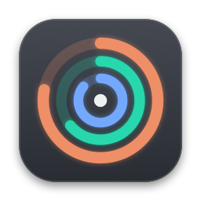
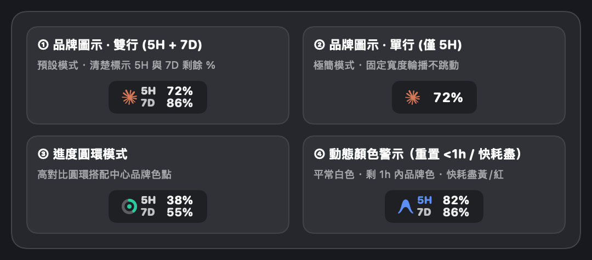
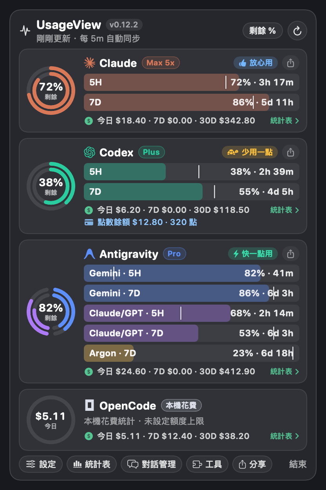
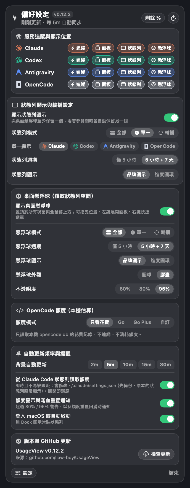

<div align="center">
  
  <h1>UsageView</h1>
  <p><b>macOS 原生狀態列 AI 額度監控工具（Claude · Codex · Antigravity · OpenCode）</b></p>
  <p>
    <a href="https://github.com/liaw-boy/UsageView/releases/latest/download/UsageView.dmg"></a>
    
    
    
    
  </p>
</div>

UsageView 常駐在狀態列（也可改用桌面懸浮球），以唯讀方式查詢各家 AI 訂閱的 5 小時與 7 天額度，並離線統計本機的 token 用量與 API 等效花費。查詢額度不會消耗任何 token 或對話次數。

---

##  下載安裝

1. 下載最新版 **[`UsageView.dmg`](https://github.com/liaw-boy/UsageView/releases/latest/download/UsageView.dmg)**。
2. 打開 `UsageView.dmg`，把 `UsageView.app` 拖進「應用程式」資料夾。
3. 首次開啟若被 macOS 擋下（未經 Apple 公證），在終端機執行：
   ```bash
   xattr -cr /Applications/UsageView.app && open /Applications/UsageView.app
   ```

之後的版本會在 App 內自動檢查並更新（每 6 小時一次，也可在設定中手動檢查），更新檔以 Ed25519 簽章驗證通過才會安裝。

---

##  畫面預覽

### 狀態列顯示模式與顏色提示

<p align="center">
  
</p>

- **平常**：白色顯示 `5H` 與 `7D` 百分比。
- **距離重置不到 1 小時**：該列轉為服務的品牌色（Claude 橘、Codex 綠、Antigravity 藍），提醒趁重置前用完。
- **額度快用完**：已用 `80%` 轉為琥珀黃，`95%` 轉為紅色。

### 主面板與偏好設定

<table>
  <tr>
    <td align="center" width="50%">
      <b>主面板（雙環儀表與配速提示）</b><br><br>
      
    </td>
    <td align="center" width="50%">
      <b>偏好設定</b><br><br>
      
    </td>
  </tr>
</table>

---

##  支援的服務

| 服務 | 額度來源 | 本機統計 |
| :--- | :--- | :--- |
| **Claude** | Claude Code 登入（唯讀）；也可從 Claude Code 狀態列即時讀取，減少 API 查詢 | `~/.claude/projects` |
| **Codex** | `~/.codex/auth.json`（唯讀） | `~/.codex/sessions` |
| **Antigravity** | `agy` 的登入（Keychain，唯讀），自動支援 Antigravity App 與 IDE | `~/.gemini/antigravity*` |
| **OpenCode** | 沒有額度 API，只讀本機 `opencode.db`；可選 Go / Go Plus / 自訂預算換算百分比（估算） | 同左 |

每家服務都有三個獨立開關：**追蹤**、**面板**、**狀態列**（開啟懸浮球後另有**懸浮球**）。未追蹤的服務完全不讀憑證、不發請求。

---

##  功能

### 狀態列與桌面懸浮球

| 設定 | 選項 | 說明 |
| :--- | :--- | :--- |
| **模式** | `全部` / `單一` / `輪播` | 並排顯示多家、固定一家，或定時輪播 |
| **週期** | `僅 5 小時` / `5 小時 + 7 天` | 單行百分比，或上下兩行 |
| **圖示** | `品牌圖示` / `進度圓環` | 各家官方圖示，或高對比圓環 |
| **百分比** | `剩餘 %` / `已用 %` | 進度條、時間刻度與雙環同步切換 |

- 狀態列與懸浮球**各有一套獨立設定**，也可只開其中一個（至少保留一個，因為 App 沒有 Dock 圖示）。
- **桌面懸浮球**：圓球或膠囊外觀，置頂於所有視窗與全螢幕上方，可拖曳並記住位置，左鍵開面板、右鍵快捷選單；滑鼠移入時變為不透明，不會超出螢幕範圍。
- 狀態列以隱藏的 `100%` 等寬模板鎖定寬度，輪播切換時不跳動、不截斷。

### 主面板

- **方案標籤與額外額度**：Claude `Max 5x` / `Max 20x` / `Pro`、Codex `Plus` / `Pro`、Antigravity `Ultra` / `Pro`，以及 Claude Extra Usage、Codex Credits。
- **時間刻度與預估**：進度條上的白色刻度標示週期已過的比例，並依消耗速度預估「重置前剩約 XX%」或「約 X 小時後用完」。
- **雙環儀表**：外環 5 小時、內環 7 天；Antigravity 分開顯示 Gemini 與 Claude/GPT 兩個額度池。
- **配速提示**：依剩餘時間與用量給出「快一點用」「放心用」「少用一點」「省著點用」「要沒了」五段建議。
- **本機花費**：離線掃描本機紀錄，顯示今日與近 30 天的 token 數和 API 等效美金。
- **分享**：卡片可透過 macOS 分享選單送出圖卡，同時複製到剪貼簿。

###  主視窗

| 頁面 | 內容 |
| :--- | :--- |
| **設定** | 服務開關、狀態列與懸浮球顯示、更新頻率、通知、開機啟動、版本更新 |
| **用量統計** | 總覽、各家對比、時段熱圖、依專案統計、額度歷史（保留 30 天） |
| **對話管理** | 瀏覽與預覽 Claude / Codex / Antigravity 對話、匯出 Markdown、一鍵移到垃圾桶釋放空間 |
| **工具管理** | 檢視 OpenCode / Claude Code / Codex 的 skill、MCP、plugin、agent，可停用或移除（檔案一律移到垃圾桶） |

### 通知與更新頻率

- 用量超過 `80%` / `95%` 時提醒；額度重置回滿時通知。
- 背景更新頻率可選 `2m` / `5m` / `10m` / `15m` / `30m`，以磁碟上的最後更新時間排程，重啟 App 或打開面板不會多打 API。
- **被官方限流（HTTP 429）時**：照伺服器要求的時間等待（上限 6 小時），沒有指定則等 5 分鐘再自動重試；期間顯示上次的資料，手動重新整理隨時可用。
- 沒有訂閱額度或登入權限不足的帳號，會直接顯示原因，不會反覆重試。

---

##  唯讀與安全

所有網路請求都必須通過 [`EndpointGuard`](Sources/QuotaBarCore/Services/EndpointGuard.swift) 白名單（只允許 HTTPS、固定的 method + host + path、不允許 query string，也不跟隨轉址）：

| 用途 | 允許的端點 |
| :--- | :--- |
| **Claude 額度** | `GET api.anthropic.com/api/oauth/usage` |
| **Codex 額度** | `GET chatgpt.com/backend-api/wham/usage` |
| **Antigravity 額度與方案** | `POST [daily-]cloudcode-pa.googleapis.com/v1internal:retrieveUserQuotaSummary`、`:loadCodeAssist` |
| **Antigravity token 續期** | `POST oauth2.googleapis.com/token` |
| **檢查更新** | `GET api.github.com/repos/liaw-boy/UsageView/releases/latest` |

- 不呼叫任何推論、重設額度或扣點的端點，也不輪換 Claude / Codex 的 OAuth refresh token。
- 原始碼不內嵌任何 API Key、OAuth Client Secret 或個人路徑；憑證只在執行時唯讀載入，access token 只存在記憶體。
- 自動更新只接受以內嵌公鑰驗證通過的 Ed25519 簽章。

---

##  編譯與測試

需要 **macOS 14 (Sonoma)** 以上與 **Swift 5.10+**（Xcode Command Line Tools）。

```bash
swift test                    # 單元測試
QUOTABAR_LOG=1 swift run      # 開發模式，印出所有通過白名單的請求
./bundle.sh                   # 打包 UsageView.app / .zip / .dmg（含圖示生成）
open UsageView.app
```

---

##  專案結構

```text
usage-statusbar/
├── Package.swift                 # SwiftPM（package 名稱 QuotaBar，產出 UsageView.app）
├── bundle.sh                     # Release 打包、圖示生成、ad-hoc codesign
├── scripts/                      # 發版、更新簽章、圖示繪製腳本
├── docs/                         # README 圖片、圖示與更新規則紀錄
├── Sources/
│   ├── QuotaBarCore/             # 資料層（無 UI）
│   │   ├── Models/               # MetricLine、ProviderSnapshot、配速模型
│   │   ├── Providers/            # Claude / Codex / Antigravity / OpenCode
│   │   ├── Services/             # EndpointGuard、HTTPClient、憑證、本機掃描、對話與工具管理、自動更新
│   │   └── Stores/               # 設定、快取與更新排程、額度歷史
│   └── QuotaBar/                 # App（AppKit + SwiftUI）
│       ├── App/                  # 進入點、狀態列、懸浮球、主視窗、工具管理視窗
│       └── Views/                # 主面板、儀表、用量統計、對話管理
└── Tests/QuotaBarTests/          # 單元測試（只依賴 QuotaBarCore）
```

---

圖示來自 [Lucide](https://lucide.dev)（ISC 授權，見 [`docs/icons/LICENSE-lucide.txt`](docs/icons/LICENSE-lucide.txt)）。
